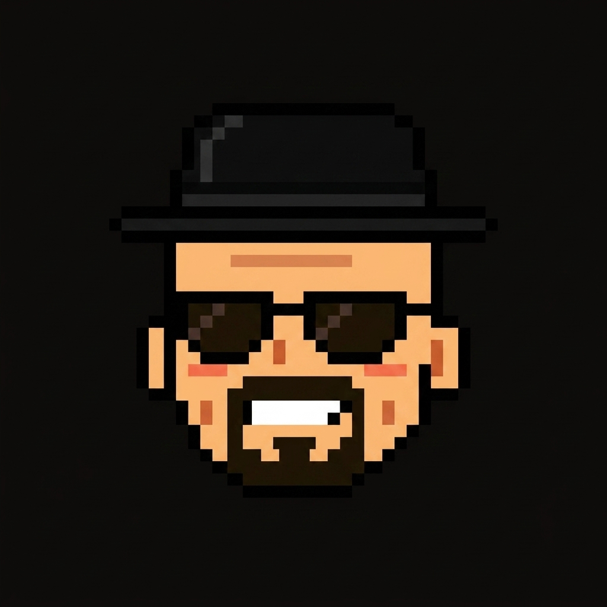

A Fun Portfolio Website Based On BreakingBad theme . 
<div align="center">




[Heisenbros](https://heisenbros-1.vercel.app/)

</div>

---

## What this is

My personal portfolio, dressed up as a character-select screen. You land on a "Player 01" intro, scroll through a few projects labelled as quests, and end on a stats card about the person behind the pixels.

It's one HTML file. I wanted something fast, easy to tweak at 2 a.m., and fun to open.

## Sections

| Section | What's in it |
| --- | --- |
| Intro | Name, one-liner, quick character stats |
| Quests | Selected projects, each with its stack |
| About | Background, skills, what I tinker with |
| Contact | How to reach me |

## Quests on the page

- **TraceX** - checks packaged-product labels, pulls the text out with OCR and shows the compliance results as a report. React, FastAPI, EasyOCR.
- **CRC Checker** - generate and verify cyclic redundancy checks with binary inputs you control. JavaScript, HTML/CSS.
- **Theft Detection** - a Raspberry Pi reads a current sensor and sends an email when something looks off. Raspberry Pi, Node-RED.

## Run it locally

There's nothing to install.

```bash
git clone https://github.com/rohitkumawat-dev/heisenbros.git
cd heisenbros
```

Then open `index.html` in your browser. If you prefer a local server:

```bash
python -m http.server 8000
```

and visit `http://localhost:8000`.

## Project layout

```
heisenbros/
├── index.html        # the whole site: markup, styles, scripts
├── heisenberg.jpeg   # avatar used on the page
├── city.png          # image asset
└── README.md
```

## Make it yours

Fork it, then change the text in `index.html`: the name, the quest cards, the stats and the links. Swap `heisenberg.jpeg` for your own picture and you're done. Deploying is just as simple, since any static host (Vercel, Netlify, GitHub Pages) will serve it as is.

## Deployment

Hosted on Vercel straight from the `main` branch. Push, and it updates.

## About me

I'm an Electronics & Telecommunication student who likes software and clean design, and I learn mostly by building things and working out why they break. More on the [live site](https://heisenbros-1.vercel.app/).

---

<div align="center">
<sub>Insert coffee to continue.</sub>
</div>
